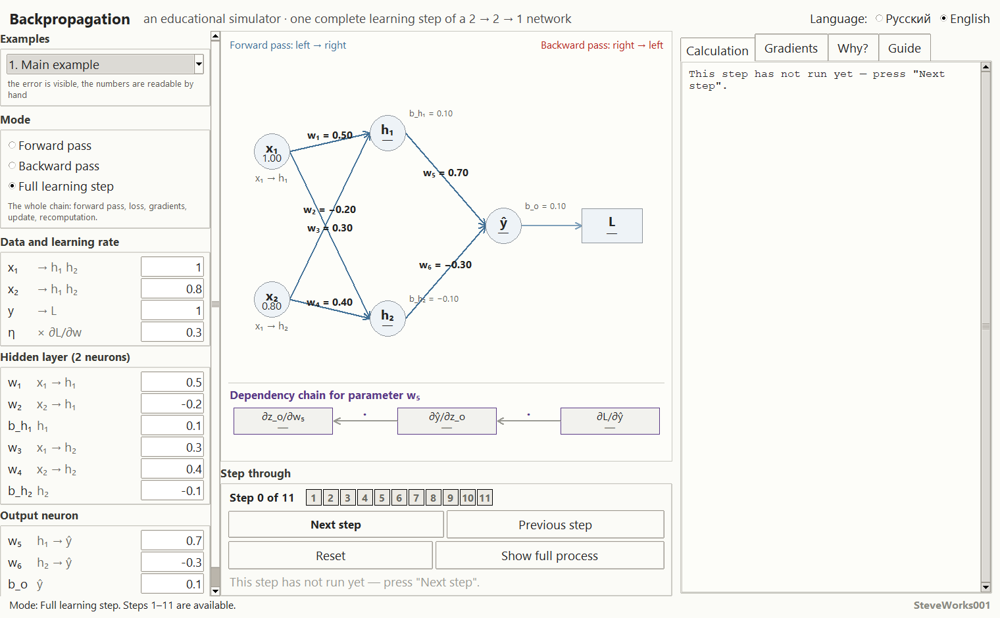
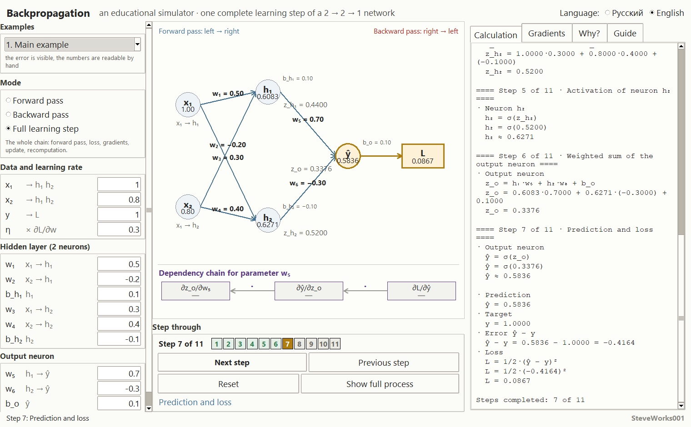
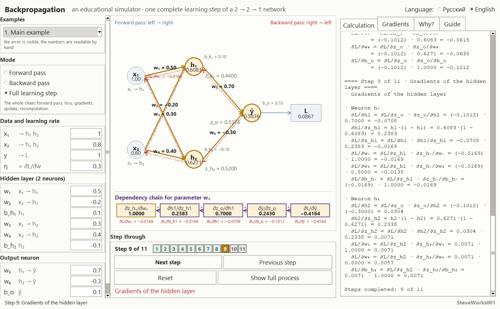
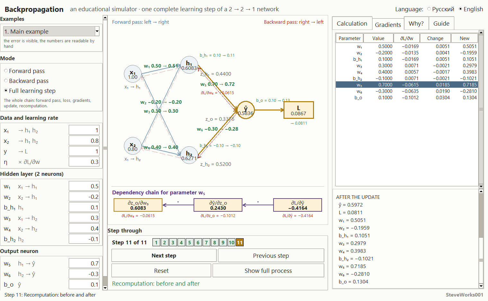

# Backpropagation — An Educational Simulator

**[Русский](README_RU.md) | [English](README_EN.md)**

Project 5 of 13 in the educational neural-network simulator series.
A single-file Python and Tkinter application: standard library only, no external
packages, no network and no dependency installation.
It shows **one completely transparent learning step** of a **2 → 2 → 1** sigmoid
network: eleven stages, and every number is printed as a formula, a substitution of
the real values, and a result.

---

## Purpose

Backpropagation is usually taught either as formulas on a whiteboard or as a
ready-made training call inside a framework, where no gradient is ever visible.
Both leave the student with a sense of magic. Here the process is split into
eleven small stages, and you can walk through them forwards and backwards,
stopping at any stage to check on paper that a
number really came from multiplying those specific factors.

No number appears on screen without the derivation that produced it. The forward
pass, the loss, the chain rule, the gradients of nine parameters, the update and the
before/after recomputation are all arithmetic you can see in full.

### What this project does not contain

- no training on a dataset: exactly **one** step on **one** example, no epochs, no
  loss curve, no automatic repetition;
- no other architecture, activation or loss function — the 2 → 2 → 1 network, the
  sigmoid and the squared loss are fixed;
- no momentum, Adam, mini-batches, regularisation or weight initialisation schemes;
- no NumPy, PyTorch, TensorFlow, network access, databases or APIs.

A sibling project in the series (Neural Network Training Lab) shows exactly what is
missing here: multi-step training on a dataset. This project answers the question
"what happens inside a single step".

---

## Learning goals

- Work through the forward pass by hand: sum → activation → sum → activation →
  output → loss, and understand why the hidden-layer values are not recomputed later.
- See that the loss `L = 1/2·(ŷ − y)²` is the only quantity the backward pass starts
  from, and that the sign of the error `ŷ − y` picks the direction of every weight.
- Understand the chain rule as a product of **local** derivatives, not as a textbook
  formula.
- Read delta notation: `∂L/∂z_o`, then `∂L/∂z_h1`, `∂L/∂z_h2`.
- Understand where the factor `1` of a bias comes from, and why the gradient of a
  hidden-layer weight contains **both** `∂L/∂z_o` **and** `σ′(z_h)`.
- Compute the update `new = old − η · ∂L/∂parameter` for all nine trainable
  parameters and see the shifts go in different directions.
- Understand that one gradient-descent step is **not obliged** to reduce the loss, and
  see the case where it increases it.
- Distinguish two outcomes: a very small `η` barely moves the parameters, a saturated
  sigmoid produces nearly zero gradients.

---

## Mathematics: a 2 → 2 → 1 network

```
      x1 ──┐                          ┌── h1 ──┐
           ├────►  [ hidden layer ]  ─┤        ├──► z_o ──σ──► ŷ ──► L
      x2 ──┘                          └── h2 ──┘

      weights: x1→h1 = w1, x2→h1 = w2, x1→h2 = w3, x2→h2 = w4
               h1→output = w5, h2→output = w6
      biases: b_h1 and b_h2 (hidden neurons), b_o (output)
```

Two inputs, a hidden layer of two neurons, one output. Nine trainable parameters in
total: six weights and three biases. Both layers use the sigmoid:

```
σ(z) = 1 / (1 + e^(−z))          σ′(z) = σ(z)·(1 − σ(z))
```

The notation is exactly what the calculation panel prints:

```
z_h1 = x1·w1 + x2·w2 + b_h1        h1 = σ(z_h1)
z_h2 = x1·w3 + x2·w4 + b_h2        h2 = σ(z_h2)
z_o  = h1·w5 + h2·w6 + b_o         ŷ  = σ(z_o)
L    = 1/2·(ŷ − y)²
```

### Forward pass and loss: stages 2–7

Every weighted sum and every activation is built with one layout:
**formula → numbers taken from the current input fields → result**. No hidden
intermediate values: `h1` is shown as a sum of products, and `σ(z_h1)` with the actual
`z_h1` substituted in.

With the default values (`x1 = 1.0`, `x2 = 0.8`, `y = 1.0`, `η = 0.30`):

```
z_h1 = 1.0000·0.5000 + 0.8000·(−0.2000) + 0.1000   = 0.4400
h1   = σ(0.4400)                                  ≈ 0.6083
z_h2 = 1.0000·0.3000 + 0.8000·0.4000 + (−0.1000)   = 0.5200
h2   = σ(0.5200)                                  ≈ 0.6271
z_o  = 0.6083·0.7000 + 0.6271·(−0.3000) + 0.1000   = 0.3376
ŷ    = σ(0.3376)                                  ≈ 0.5836

ŷ − y = 0.5836 − 1.0000 = −0.4164
L = 1/2·(−0.4164)² = 0.0867
```

The sign of the error matters: it decides which way every weight moves.

### Backward pass: stages 8 and 9

First in words, without formulas. The chain rule does not "compute some clever dependence of
the loss on a distant weight" in one move. Each node of the network knows exactly one thing:
how strongly **its own** output responds to **its own** input. That is a local response — the
derivative of one short piece of the graph. To find out how the loss responds to `w₁`, the
local responses are multiplied along the path:

```
∂L/∂w₁ = ∂L/∂ŷ · ∂ŷ/∂z_o · ∂z_o/∂h₁ · ∂h₁/∂z_h₁ · ∂z_h₁/∂w₁
```

With the numbers of example 1 that is (−0.4164) · 0.2430 · 0.7000 · 0.2383 · 1.0000 = −0.0169
— exactly the `∂L/∂w₁` the application prints at stage 9. Hence the main consequence, visible in
example 6: if one local response is small (`σ′(z_o) = 0.0067` on a saturated sigmoid), the whole
product becomes small, no matter how large the other factors are.

This is the educational core. First the derivative of the loss with respect to the
output, then the local derivatives of the layer, then their product:

```
∂L/∂ŷ   = ŷ − y
∂ŷ/∂z_o = σ′(z_o) = ŷ·(1 − ŷ)
∂L/∂z_o = ∂L/∂ŷ · ∂ŷ/∂z_o                 (this is δ_o)

∂L/∂w5  = ∂L/∂z_o · ∂z_o/∂w5   = δ_o · h1
∂L/∂w6  = ∂L/∂z_o · ∂z_o/∂w6   = δ_o · h2
∂L/∂b_o = ∂L/∂z_o · ∂z_o/∂b_o  = δ_o · 1

∂L/∂h1  = ∂L/∂z_o · w5                    ∂L/∂h2 = ∂L/∂z_o · w6
∂h1/∂z_h1 = h1·(1 − h1)                   ∂h2/∂z_h2 = h2·(1 − h2)
∂L/∂z_h1  = ∂L/∂h1 · ∂h1/∂z_h1  (= δ_h1)  ∂L/∂z_h2 = …          (= δ_h2)

∂L/∂w1 = δ_h1·x1    ∂L/∂w2 = δ_h1·x2    ∂L/∂b_h1 = δ_h1·1
∂L/∂w3 = δ_h2·x1    ∂L/∂w4 = δ_h2·x2    ∂L/∂b_h2 = δ_h2·1
```

The same computation on the default numbers:

```
∂L/∂ŷ   = 0.5836 − 1.0000            = −0.4164
∂ŷ/∂z_o = 0.5836·(1 − 0.5836)        =  0.2430
∂L/∂z_o = (−0.4164) · 0.2430         = −0.1012

∂L/∂w5  = (−0.1012) · 0.6083         = −0.0615
∂L/∂w6  = (−0.1012) · 0.6271         = −0.0635
∂L/∂b_o = (−0.1012) · 1.0000         = −0.1012

∂L/∂h1  = (−0.1012) · 0.7000         = −0.0708     ∂L/∂h2 = (−0.1012)·(−0.3000) = 0.0304
∂h1/∂z_h1 = 0.6083·(1 − 0.6083)      =  0.2383     ∂h2/∂z_h2 = 0.6271·(1 − 0.6271) = 0.2338
∂L/∂z_h1  = (−0.0708) · 0.2383       = −0.0169     ∂L/∂z_h2  = 0.0304 · 0.2338     = 0.0071

∂L/∂w1 = (−0.0169)·1.0000 = −0.0169   ∂L/∂w3 = 0.0071·1.0000 = 0.0071
∂L/∂w2 = (−0.0169)·0.8000 = −0.0135   ∂L/∂w4 = 0.0071·0.8000 = 0.0057
∂L/∂b_h1 = −0.0169                     ∂L/∂b_h2 = 0.0071
```

The factors are taken **only** locally — each is a derivative of one step of the
graph. Putting the ready-made `∂L/∂h1` in place of `w5` would make `∂L/∂z_o` enter
the product twice and the gradient would be wrong. The application says this out loud
at stage 9.

### Update and recomputation: stages 10 and 11

`new_parameter = old_parameter − η · ∂L/∂parameter` for all nine parameters; at
`η = 0.30` this gives:

| Parameter | Old | `∂L/∂w` | Change | New |
|---|---|---|---|---|
| w₁ | 0.5000 | −0.0169 | 0.0051 | 0.5051 |
| w₂ | −0.2000 | −0.0135 | 0.0041 | −0.1959 |
| b_h₁ | 0.1000 | −0.0169 | 0.0051 | 0.1051 |
| w₃ | 0.3000 | 0.0071 | −0.0021 | 0.2979 |
| w₄ | 0.4000 | 0.0057 | −0.0017 | 0.3983 |
| b_h₂ | −0.1000 | 0.0071 | −0.0021 | −0.1021 |
| w₅ | 0.7000 | −0.0615 | 0.0185 | 0.7185 |
| w₆ | −0.3000 | −0.0635 | 0.0190 | −0.2810 |
| b_o | 0.1000 | −0.1012 | 0.0304 | 0.1304 |

This table shows the main point: `b_h₁` and `b_o` move exactly as `∂L/∂z_h1` and
`∂L/∂z_o` dictate, because their local derivative is `1`. The sign of the gradient
sets the direction: where `∂L/∂w` is negative the parameter grows, where it is
positive the parameter shrinks.

Stage 11 recomputes the network with the new parameters and shows the before/after
comparison:

```
ŷ :  0.5836 → 0.5972
L :  0.0867 → 0.0811
```

**Important:** one gradient-descent step does not guarantee that the loss goes down.
With a large `η` the step can be too coarse and increase the error — the simulator
shows that instead of hiding it. A statement like "the loss decreased" applies only to
the selected example and the selected `η`.

---

## Interface and usage

**Left** — the "Examples" box (a dropdown of six number sets plus a caption saying
what the selected one demonstrates), the "Mode" box with three radio buttons and a
hint under them, and three groups of input fields: "Data and learning rate" (`x1`,
`x2`, `y`, `η`), "Hidden layer (2 neurons)" (`w1`, `w2`, `b_h1`, `w3`, `w4`, `b_h2`)
and "Output neuron" (`w5`, `w6`, `b_o`). Next to every field is a caption saying where
that parameter comes from (`x₁ → h₁`, `h₂ → ŷ`) — it is not translated, like the
formulas themselves. The column scrolls with the mouse wheel when it does not fit the
window height.

**Centre** — the network graph, built from the model rather than from a picture: the
nodes `x₁`, `x₂`, `h₁`, `h₂`, `ŷ` and `L`, the per-neuron sum labels, the bias values
beside their own neurons and, under the graph, the chain-rule band. Below the graph
sits the "Step through" strip: a counter of the `Step 3 of 11` form, eleven clickable
stage dots, four buttons and the name of the current stage.

**Right** — four tabs: "Calculation", "Gradients", "Why?" and "Guide".

**Bottom** — a status line with the latest message.

### Moving through the stages

The eleven stages always run in a fixed order:

| Stage | Title |
|---|---|
| 1 | Inputs, target and network parameters |
| 2 | Weighted sum of neuron h₁ |
| 3 | Activation of neuron h₁ |
| 4 | Weighted sum of neuron h₂ |
| 5 | Activation of neuron h₂ |
| 6 | Weighted sum of the output neuron |
| 7 | Prediction and loss |
| 8 | Gradient of the output layer |
| 9 | Gradients of the hidden layer |
| 10 | Updating every parameter |
| 11 | Recomputation: before and after |

- **Mode** (three radio buttons): "Forward pass" (stages 1–7), "Backward pass"
  (8–11), "Full learning step" (1–11, the default at startup). Changing the mode
  clears the progress and keeps your parameter values.
- **Buttons**: "Next step" (exactly one stage per press), "Previous step", "Reset"
  (clears progress, keeps the field values), "Show full process" (switches to the full
  mode and prints all eleven stages at once).
- **Stage dots** are clickable: they jump to any stage available in the current mode.
  Asking for another stage leaves a message in the status line saying which steps the
  mode allows — no silent refusal.
- Before the first press the calculation panel says the step has not run yet, while
  the fields, the graph and the gradient table already show the current values, so the
  computation that is about to happen can be read in advance.
- At the bottom of the calculation panel there is a line `Steps completed: N of 11` — how
  many stages have actually been revealed. The heading of each revealed stage reads
  `Step N of 11`: two places for one counter, and `N` means the same thing in both. Before the
  first press, that number is replaced by the message telling you the step has not run yet and
  asking you to press `Next step`.


### What is hidden until its time

The application deliberately does not reveal an answer before the student has derived
it:

- on the graph `h₁` appears only from stage 3, `h₂` from stage 5, `ŷ` from stage 6 and
  the number in the `L` node from stage 7 — until then a dash sits in their place;
- the gradient table shows `∂L/∂w₅`, `∂L/∂w₆`, `∂L/∂b_o` only from stage 8 and the
  hidden-layer gradients only from stage 9; before that the three right-hand columns
  hold dashes;
- the chain-rule band lays its factors out right to left — from `∂L/∂ŷ` towards the
  parameter in question — and while the backward pass has not reached that parameter,
  the blocks show dashes instead of numbers. The running product is printed under
  every factor, so you can watch each intermediate derivative appear in turn:
  `∂L/∂ŷ`, `∂L/∂z_o`, `∂L/∂h₁`, `∂L/∂z_h₁` and finally the gradient of the parameter
  itself.

### Tabs

- **"Calculation"** — the full record of the path travelled: stages one to the current
  one follow each other in a single text, each with its heading and its numbers. Passed
  stages are not overwritten, they accumulate, so the whole learning step reads like
  one sheet of paper, and the panel ends with a line saying how many steps are done.
- **"Gradients"** — a table of all nine parameters with the columns `Parameter`,
  `Value`, `∂L/∂w`, `Change`, `New`, and under it the "BEFORE THE UPDATE" and "AFTER
  THE UPDATE" panels (`ŷ`, `L` and all nine values). Selecting a row points the
  chain-rule band under the graph at that parameter and reports the choice in the
  status line.
- **"Why?"** — an explanation of the current stage, with the numbers of this very step:
  what the stage is for and which values it keeps for the stages that follow. From
  stage 11 a "What happened?" block is added below: how the loss changed, which two
  parameters moved the most, and where the gradient turned out to be zero.
- **"Guide"** — a built-in handbook of 10 sections: what backpropagation is, the
  forward pass, the weighted sum, activation, the loss function, the chain rule,
  gradients, the backward pass, gradient descent, and one complete learning step.

### Input fields

Decimal numbers are accepted with a dot and with a comma (`0,5` and `0.5` mean the
same). Invalid text does not crash the app: the field is highlighted, the last correct
value is kept and the status line reports what happened. Values outside the allowed
range are clamped to the nearest bound with the same kind of warning:

```
inputs, weights and biases   −3 … 3
target y                      0 … 1
learning rate η               0 … 1.5
```

The limits are soft: their purpose is to keep numbers from running off to infinity,
not to restrict learning experiments. The upper bound `η = 1.5` is kept on purpose so
that a deliberately too-large step can be observed.

### Examples

Six ready sets of numbers; loading an example refills **every** field consistently and
clears the progress.

| Example | What it shows |
|---|---|
| 1. Main example | the error is visible and the numbers are readable by hand: `ŷ = 0.5836`, `L = 0.0867` |
| 2. Target equals 0 | same network, opposite sign of the error: `ŷ − y = +0.5836`, `L = 0.1703` |
| 3. Prediction close to target | small loss — small gradients: `L = 0.0184`, the largest shift is `0.0089` |
| 4. Very small η | `η = 0.02`: the parameters barely move and the loss hardly changes |
| 5. Negative weights and input | gradient signs alternate: some parameters grow, others shrink |
| 6. Saturating sigmoid | `ŷ = 0.9933`: `σ′(z_o) = 0.0067`, so three gradients print as `0.0000`, six print as `−0.0000` (negative zero), and the new values coincide with the old ones |

Example 4 shows that a small `η` does not "fix" learning, it only stretches it over
time; example 6 shows that a saturated sigmoid barely learns, because the derivative of
the activation turns the whole chain into zeros.

### Language

The interface is fully translated at runtime, without restarting and without losing the
entered numbers or the current stage: headings, labels, stage names and descriptions,
explanations, the table, invalid-input messages and example names. Mathematical notation
(`∂`, `σ`, `ŷ`, `η`, subscripts ₁…₆) is identical in both languages and is never
translated.

---

## Screenshots

The images come from the running application: window 1520 × 940 pixels, English interface,
example `1. Main example`, mode "Full learning step".

**Main window** — the state before the first step: `Step 0 of 11`, the "Calculation" tab holds
a single line `This step has not run yet — press "Next step".`, and the status bar reads
"Mode: Full learning step. Steps 1–11 are available.". The graph shows the 2 → 2 → 1 network
with its default weights (`w₁ = 0.50`, `w₂ = −0.20`, `w₃ = 0.30`, `w₄ = 0.40`, `w₅ = 0.70`,
`w₆ = −0.30`, `b_h₁ = 0.10`, `b_h₂ = −0.10`, `b_o = 0.10`) and inputs `x₁ = 1.00`,
`x₂ = 0.80`; below the graph the dependency chain of the selected parameter `w₅` is still an
empty frame:



**Forward pass** — step 7 of 11, "Prediction and loss". The "Calculation" tab is scrolled to
the end, so the result of the whole forward pass is visible: `h₁ = σ(0.4400) ≈ 0.6083`,
`h₂ = σ(0.5200) ≈ 0.6271`, `z_o = 0.3376`, `ŷ = σ(0.3376) ≈ 0.5836`,
`ŷ − y = 0.5836 − 1.0000 = −0.4164` and `L = 1/2·(−0.4164)² = 0.0867`. The same numbers label
the nodes and the loss block on the graph:



**Backward pass** — step 9 of 11, "Gradients of the hidden layer". The chain rule is
printed factor by factor: `∂L/∂ŷ = −0.4164`, `∂L/∂z_o = −0.1012`, `∂L/∂w₅ = −0.0615`;
for neuron `h₁` — `∂L/∂h1 = ∂L/∂z_o · ∂z_o/∂h1 = (−0.1012) · 0.7000 = −0.0708`,
`∂L/∂z_h1 = ∂L/∂h1 · ∂h1/∂z_h1 = −0.0708 · 0.2383 = −0.0169`, and therefore
`∂L/∂w₁ = ∂L/∂z_h1 · ∂z_h₁/∂w₁ = (−0.0169) · 1.0000 = −0.0169`. In the image the table
row `w₁` is selected, and the chain below the graph has been rebuilt for that parameter:



**Parameter update** — step 11 of 11, the "Gradients" tab. The table lists all nine
parameters: value, gradient, change and new value; the highlighted row is `w₅` —
`0.7000`, `−0.0615`, `0.0185`, `0.7185`. Below it the "AFTER THE UPDATE" panel reads
`ŷ = 0.5972`, `L = 0.0811`, against `0.5836` and `0.0867` in "BEFORE THE UPDATE". On the graph
the transitions are printed next to the edges (`w₅ 0.70 → 0.72`) and the losses
(`L 0.0867 → 0.0811`):



---

## Guided experiments

The numbers below come from the application's own computation on its built-in examples, and they
reproduce exactly: load the same example and you get the same lines.

**1. Read the chain once.** Start the program (example 1, "Full learning step" mode) and walk to
stage 9 with the "Next step" button.
Observe: the bottom of the calculation panel reads `Steps completed: 9 of 11`, and the chain-rule
strip shows the factors along the path to the parameter. Multiply the five numbers for `w₁`
yourself: (−0.4164) · 0.2430 · 0.7000 · 0.2383 · 1.0000 = −0.0169 — the application prints
exactly that.
Think about: why this chain contains `w₅` and `h₁` but neither `h₂` nor `w₃` — and what the chain
for `w₃` would look like.

**2. One network, opposite target.** Load example 1 and write down the gradients, then load
example 2 (only `y = 0` differs there).
Observe: `ŷ` stays `0.5836`, but `∂L/∂ŷ` becomes `+0.5836` instead of `−0.4164`, and all nine
gradients flip sign: `w₁` had `−0.0169` and now has `+0.0237`; the loss is larger as well
(`L = 0.1703` instead of `0.0867`).
Think about: if the prediction is the same, how does the backward pass "know" which way to push
the weights — and in which factor exactly that sign lives.

**3. Saturation versus "simply a small error".** Compare examples 3 and 6, walking each to
stage 11.
Observe: in example 6 `ŷ = 0.9933` and `σ′(z_o) = 0.0067`, so three gradients print as
`0.0000` and six as `−0.0000`; the new parameter values equal the old ones. Example 3 is also close to its target
(`L = 0.0184`), yet its backward pass produces a visible shift: the largest update is `0.0089`
on `b_o`.
Think about: which is worse for learning — a large error on a steep slope or a small error in a
flat place, and whether the loss alone lets you tell them apart.

**4. `η` sits outside the chain.** On example 1, walk a full step with `η = 0.30` and note
stages 8–11 and 10–11: `∂L/∂w₅ = −0.0615`, `w₅` moves by `+0.0185`, the loss goes
`0.0867 → 0.0811`. Set `η = 1.5` and repeat the step, then set `η = 0`.
Observe: the numbers at stages 8 and 9 do not change at all — only the increments do (`w₅` moves
by `+0.0923`, the loss goes `0.0867 → 0.0612`). With `η = 0` the gradients are the same, every
update is zero, and the recomputation at stage 11 returns exactly the same numbers.
Think about: why `η` appears in none of the chain-rule factors, and under what arrangement too
large an `η` would start making the loss worse instead of better.

---

## Installation and launch

The application is a single file; no build step and no dependency installation.

Windows:

```bash
python backpropagation.py
```

macOS and Linux:

```bash
python3 backpropagation.py
```

The window opens at roughly the screen size (up to about 1520×940) and does not shrink
below about 1300×780. Quick start: the main example is already loaded and the "Full
learning step" mode is on, so eleven presses of `Next step` put the entire learning step
on screen.

The language switch sits in the window header: **Русский** / **English**.

---

## Requirements

- Python 3.8 or newer.
- Tkinter — included in the official Python installers for Windows and macOS; on some
  Linux distributions it is installed separately as the `python3-tk` package.
- Standard library only: `math`, `tkinter`, `tkinter.ttk`, `tkinter.font`.
- Not used: NumPy, pandas, SciPy, matplotlib, Pillow, TensorFlow, PyTorch, Keras,
  scikit-learn or any `pip` package.
- No network connection is needed while the application runs.

The app targets a typical desktop display: the network graph occupies the centre of the
window, so in a very narrow window the graph drops the per-neuron sum labels and moves
the gradient of the selected parameter onto its own line — the numbers themselves stay
available in the calculation panel.

---

## Limitations

- **One** complete learning step is demonstrated, not multi-epoch training: after
  stage 11 the loop does not repeat automatically and no history is accumulated.
- The architecture is fixed: 2 → 2 → 1, sigmoid, loss `1/2·(ŷ − y)²`. Another
  architecture, activation function or loss function cannot be configured.
- One example at a time: several "input → target" pairs are not trained together.
- Numbers are printed with four digits after the decimal point, so multiplying the
  already-rounded factors can differ from the printed result in the last digit.
- The arithmetic uses ordinary `float` precision: with a very small `η` the parameter
  shift becomes indistinguishable from zero on screen, which is a property of the
  display format rather than a computation error.
- The backward pass is shown for one parameter at a time: you can select a parameter and
  watch its chain, but the app never builds a Jacobian matrix or a derivation for an
  arbitrary number of layers.
- Graphical interface only: no console mode, API or batch run.
- No saving or loading: the state is not written to files and the derivation is not
  exported.
- Two interface languages: Russian and English.

---

## Educational note

The simulator explains one mechanism — how the gradient of every parameter comes out of
the loss and the local derivatives, and how a single step changes the network. Some
conventions are chosen for clarity rather than because production systems do the same:
the loss `1/2·(ŷ − y)²` is written in the form where the `1/2` cancels on
differentiation; the backward pass is shown for one example and one pass; the input
limits (`−3…3`, `0…1`, `η` up to `1.5`) exist so that numbers stay readable; and the
order of stages is fixed, although it is not the only possible one. All nine parameters
are updated with the same `η` — real training schedules do it differently.

---

## What to know beforehand

**Hard requirements:** Python 3 with Tkinter, and running one file from a command line. No `pip`
packages, no network, no external files.

**Mathematics:** understanding a derivative as the answer to "how fast does this number change
when that one changes". Rules for differentiating complicated expressions are not required: every
derivative used here — `σ′(z) = σ(z)(1 − σ(z))` and the derivative of a sum with respect to one
term — is already computed and shown on screen as its own factor. Care with negative numbers and
the habit of multiplying a chain through without rounding in the middle both help.

**Useful but not required:** project 4 ("Gradient Descent") — there one parameter moves along a
derivative that is handed over ready-made; here you see how such a derivative is obtained for a
weight inside a network. Project 3 ("Mini Neural Network") makes the forward pass familiar, which
forms stages 1–7 here.

**About the Python version:** the Requirements section names Python 3.8 or newer. The application
never checks the version and no other version has been run — that is declared compatibility, not
a verified guarantee.

---

## Place in the series

Project 5 of 13. The order is not strict: every project launches on its own and reads nothing
from its neighbours. Only connections that exist by subject are listed.

| Project | Connection by subject |
|---|---|
| 1 — One Artificial Neuron | there `σ(z)` and its answer are taken apart; here `σ′(z)` becomes a factor of the chain |
| 3 — Mini Neural Network | the same forward pass over the same layer structure — here it is also run backwards |
| 4 — Gradient Descent | a step against the gradient's direction; this project shows where that gradient comes from |
| 6 — Neural Network Training | the same backward pass applied many times, with a loss curve |
| 7 — Activation Functions | the shape of `σ′(z)` explains example 6: why a saturated sigmoid barely learns |
| 8 — Loss Functions | with a different loss, the first chain factor (`∂L/∂ŷ`) would be a different number |

---

## Developer

**Developer: SteveWorks001**

---

## License

This project is distributed under the [MIT License](LICENSE).
