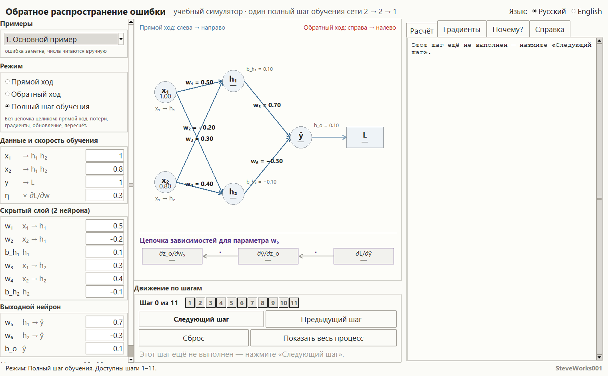
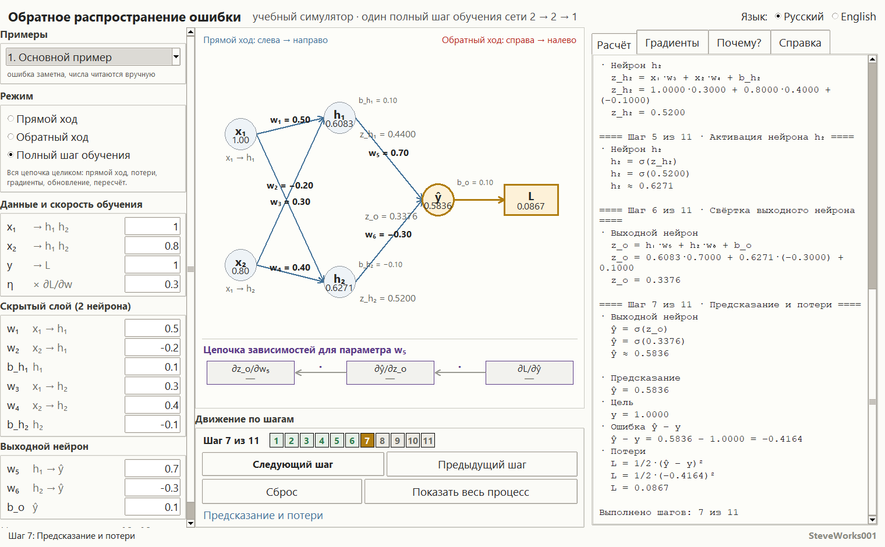
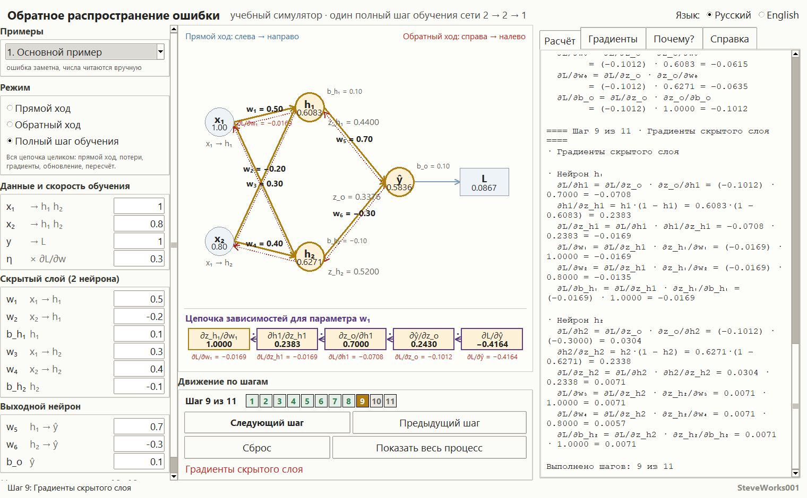
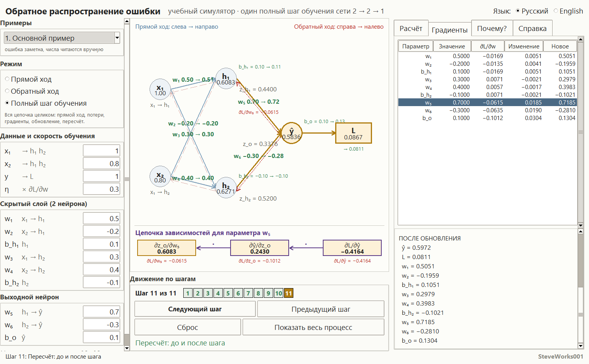

# Backpropagation — An Educational Simulator

**[Русский](README_RU.md) | [English](README_EN.md)**

Проект 5 из 13 серии учебных симуляторов нейронных сетей.
Однофайловое приложение на Python и Tkinter: только стандартная библиотека,
без внешних пакетов, без сети и без установки зависимостей.
Показывает **один полностью прозрачный шаг обучения** сети **2 → 2 → 1** на
сигмоиде: одиннадцать стадий, и каждая цифра выводится как формула, подстановка
настоящих чисел и результат.

---

## Назначение

Обычно обратное распространение ошибки показывают либо формулами на доске, либо
готовым вызовом обучения в фреймворке, где градиенты нигде не видны. И то и другое
оставляет студента с ощущением магии. Здесь процесс разведён на одиннадцать
маленьких стадий, и по ним можно идти вперёд и назад, останавливаясь на любой
стадии и проверяя на бумаге, что число получилось умножением именно этих
множителей.

Ни одна цифра не появляется на экране без вывода, из которого она получилась.
Прямой ход, потери, цепное правило, градиенты девяти параметров, обновление и
пересчёт «до и после» — всё это арифметика, которую видно целиком.

### Чего в этом проекте нет

- нет обучения по датасету: ровно **один** шаг на **одном** примере, без эпох,
  без кривой потерь и без автоматического повтора;
- нет других архитектур, других активаций и других функций потерь — сеть
  2 → 2 → 1, сигмоида, квадратичные потери фиксированы;
- нет momentum, Adam, мини-батчей, регулярлизации и инициализации весов;
- нет NumPy, PyTorch, TensorFlow, сети, баз данных и API.

Соседний проект серии (Neural Network Training Lab) показывает как раз то, чего
нет здесь: многошаговое обучение на датасете. Этот проект отвечает на вопрос
«что происходит внутри одного шага».

---

## Учебные цели

- Пройти прямой ход руками: свёртка → активация → свёртка → активация → выход →
  потери, и понять, почему значения скрытого слоя потом не пересчитываются.
- Увидеть, что потери `L = 1/2·(ŷ − y)²` — единственная величина, от которой
  стартует обратный ход, и что знак ошибки `ŷ − y` выбирает направление сдвига
  каждого веса.
- Понять цепное правило как произведение **локальных** производных, а не как
  «формулу из учебника».
- Разобрать дельта-запись: `∂L/∂z_o`, затем `∂L/∂z_h1`, `∂L/∂z_h2`.
- Понять, откуда берётся множитель `1` у смещений и почему градиент веса
  скрытого слоя содержит **и** `∂L/∂z_o`, **и** `σ′(z_h)`.
- Посчитать обновление `новый = старый − η · ∂L/∂параметр` для всех девяти
  обучаемых параметров и увидеть разный знак сдвигов.
- Понять, что один шаг градиентного спуска **не обязан** уменьшать потери, и
  увидеть, когда он их увеличивает.
- Различать два режима исхода: очень малая `η` даёт почти незаметный сдвиг,
  насыщенная сигмоида — почти нулевые градиенты.

---

## Математика: сеть 2 → 2 → 1

```
      x1 ──┐                          ┌── h1 ──┐
           ├────►  [ скрытый слой ]  ─┤        ├──► z_o ──σ──► ŷ ──► L
      x2 ──┘                          └── h2 ──┘

      веса: x1→h1 = w1, x2→h1 = w2, x1→h2 = w3, x2→h2 = w4
            h1→выход = w5, h2→выход = w6
      смещения: b_h1 и b_h2 (скрытые нейроны), b_o (выход)
```

Два входа, скрытый слой из двух нейронов, один выход. Обучаемых параметров
девять: шесть весов и три смещения. Оба слоя используют сигмоиду:

```
σ(z) = 1 / (1 + e^(−z))          σ′(z) = σ(z)·(1 − σ(z))
```

Обозначения ровно те, что печатает панель расчёта:

```
z_h1 = x1·w1 + x2·w2 + b_h1        h1 = σ(z_h1)
z_h2 = x1·w3 + x2·w4 + b_h2        h2 = σ(z_h2)
z_o  = h1·w5 + h2·w6 + b_o         ŷ  = σ(z_o)
L    = 1/2·(ŷ − y)²
```

### Прямой ход и потери: стадии 2–7

Для каждой свёртки и каждой активации вывод строится по одной схеме:
**формула → числа из текущих полей → результат**. Никаких величин «в памяти»:
`h1` показан как сумма произведений, а `σ(z_h1)` — с подставленным `z_h1`.

На значениях по умолчанию (`x1 = 1.0`, `x2 = 0.8`, `y = 1.0`, `η = 0.30`):

```
z_h1 = 1.0000·0.5000 + 0.8000·(−0.2000) + 0.1000   = 0.4400
h1   = σ(0.4400)                                  ≈ 0.6083
z_h2 = 1.0000·0.3000 + 0.8000·0.4000 + (−0.1000)   = 0.5200
h2   = σ(0.5200)                                  ≈ 0.6271
z_o  = 0.6083·0.7000 + 0.6271·(−0.3000) + 0.1000   = 0.3376
ŷ    = σ(0.3376)                                  ≈ 0.5836

ŷ − y = 0.5836 − 1.0000 = −0.4164
L = 1/2·(−0.4164)² = 0.0867
```

Знак ошибки важен: он решает, в какую сторону сдвинется каждый вес.

### Обратный ход: стадии 8 и 9

Сначала — словами, без формул. Цепное правило не «высчитывает хитрую зависимость потерь от
далёкого веса» одним движением. Каждый узел сети знает только одно: как сильно **его
собственный** выход отзывается на **его собственный** вход. Это локальный отклик —
производная одного короткого куска графа. Чтобы узнать, как потери отзовутся на `w₁`,
локальные отклики перемножают вдоль пути:

```
∂L/∂w₁ = ∂L/∂ŷ · ∂ŷ/∂z_o · ∂z_o/∂h₁ · ∂h₁/∂z_h₁ · ∂z_h₁/∂w₁
```

На числах примера 1 это (−0.4164) · 0.2430 · 0.7000 · 0.2383 · 1.0000 = −0.0169 — ровно тот
`∂L/∂w₁`, который приложение печатает на стадии 9. Отсюда главное следствие, которое видно в
примере 6: если один из локальных откликов мал (`σ′(z_o) = 0.0067` на насыщенной сигмоиде),
маленьким становится всё произведение, какие бы крупные числа ни стояли в остальных звеньях.

Это смысловой центр проекта. Сначала производная потерь по выходу, затем
локальные производные слоя, затем их произведение:

```
∂L/∂ŷ   = ŷ − y
∂ŷ/∂z_o = σ′(z_o) = ŷ·(1 − ŷ)
∂L/∂z_o = ∂L/∂ŷ · ∂ŷ/∂z_o                 (это и есть δ_o)

∂L/∂w5  = ∂L/∂z_o · ∂z_o/∂w5   = δ_o · h1
∂L/∂w6  = ∂L/∂z_o · ∂z_o/∂w6   = δ_o · h2
∂L/∂b_o = ∂L/∂z_o · ∂z_o/∂b_o  = δ_o · 1

∂L/∂h1  = ∂L/∂z_o · w5                    ∂L/∂h2 = ∂L/∂z_o · w6
∂h1/∂z_h1 = h1·(1 − h1)                   ∂h2/∂z_h2 = h2·(1 − h2)
∂L/∂z_h1  = ∂L/∂h1 · ∂h1/∂z_h1  (= δ_h1)  ∂L/∂z_h2 = …          (= δ_h2)

∂L/∂w1 = δ_h1·x1    ∂L/∂w2 = δ_h1·x2    ∂L/∂b_h1 = δ_h1·1
∂L/∂w3 = δ_h2·x1    ∂L/∂w4 = δ_h2·x2    ∂L/∂b_h2 = δ_h2·1
```

Тот же расчёт на числах по умолчанию:

```
∂L/∂ŷ   = 0.5836 − 1.0000            = −0.4164
∂ŷ/∂z_o = 0.5836·(1 − 0.5836)        =  0.2430
∂L/∂z_o = (−0.4164) · 0.2430         = −0.1012

∂L/∂w5  = (−0.1012) · 0.6083         = −0.0615
∂L/∂w6  = (−0.1012) · 0.6271         = −0.0635
∂L/∂b_o = (−0.1012) · 1.0000         = −0.1012

∂L/∂h1  = (−0.1012) · 0.7000         = −0.0708     ∂L/∂h2 = (−0.1012)·(−0.3000) = 0.0304
∂h1/∂z_h1 = 0.6083·(1 − 0.6083)      =  0.2383     ∂h2/∂z_h2 = 0.6271·(1 − 0.6271) = 0.2338
∂L/∂z_h1  = (−0.0708) · 0.2383       = −0.0169     ∂L/∂z_h2  = 0.0304 · 0.2338     = 0.0071

∂L/∂w1 = (−0.0169)·1.0000 = −0.0169   ∂L/∂w3 = 0.0071·1.0000 = 0.0071
∂L/∂w2 = (−0.0169)·0.8000 = −0.0135   ∂L/∂w4 = 0.0071·0.8000 = 0.0057
∂L/∂b_h1 = −0.0169                     ∂L/∂b_h2 = 0.0071
```

Множители берутся **только** локальные — производные одного шага графа. Если
поставить вместо `w5` уже готовое `∂L/∂h1`, множитель `∂L/∂z_o` войдёт в
произведение дважды, и градиент станет неверным. Приложение об этом говорит
прямо на стадии 9.

### Обновление и пересчёт: стадии 10 и 11

`параметр_новый = параметр_старый − η · ∂L/∂параметр` для всех девяти
параметров; при `η = 0.30` получается:

| Параметр | Старое | `∂L/∂w` | Изменение | Новое |
|---|---|---|---|---|
| w₁ | 0.5000 | −0.0169 | 0.0051 | 0.5051 |
| w₂ | −0.2000 | −0.0135 | 0.0041 | −0.1959 |
| b_h₁ | 0.1000 | −0.0169 | 0.0051 | 0.1051 |
| w₃ | 0.3000 | 0.0071 | −0.0021 | 0.2979 |
| w₄ | 0.4000 | 0.0057 | −0.0017 | 0.3983 |
| b_h₂ | −0.1000 | 0.0071 | −0.0021 | −0.1021 |
| w₅ | 0.7000 | −0.0615 | 0.0185 | 0.7185 |
| w₆ | −0.3000 | −0.0635 | 0.0190 | −0.2810 |
| b_o | 0.1000 | −0.1012 | 0.0304 | 0.1304 |

Здесь видно главное: `b_h₁` и `b_o` сдвигаются ровно на столько, на сколько
сдвинутся `∂L/∂z_h1` и `∂L/∂z_o` — потому что их локальная производная равна
`1`. Знак градиента решает направление: где `∂L/∂w` отрицательный, параметр
растёт; где положительный — уменьшается.

Стадия 11 пересчитывает сеть с новыми параметрами и показывает сравнение
«до и после»:

```
ŷ :  0.5836 → 0.5972
L :  0.0867 → 0.0811
```

**Важно:** один шаг градиентного спуска не гарантирует, что потери станут
меньше. При большой `η` шаг может оказаться слишком грубым и увеличить ошибку —
симулятор это показывает, а не прячет. Утверждение «потери упали» относится
только к выбранному примеру и выбранной `η`.

---

## Интерфейс и как пользоваться

**Слева** — блок «Примеры» (выпадающий список из шести наборов и подпись, что
показывает выбранный), блок «Режим» с тремя переключателями и пояснением под
ними, и три группы полей ввода: «Данные и скорость обучения» (`x1`, `x2`, `y`,
`η`), «Скрытый слой (2 нейрона)» (`w1`, `w2`, `b_h1`, `w3`, `w4`, `b_h2`) и
«Выходной нейрон» (`w5`, `w6`, `b_o`). У каждого поля рядом подпись, откуда идёт
этот параметр (`x₁ → h₁`, `h₂ → ŷ`), — она не переводится, как и формулы.
Колонка прокручивается колесом мыши, если не вмещается по высоте.

**В центре** — граф сети, построенный из модели, а не из картинки: узлы `x₁`,
`x₂`, `h₁`, `h₂`, `ŷ` и `L`, подписи свёрток у нейронов, значения смещений у
своих нейронов и — под графом — полоса цепного правила. Под графом находится
полоса «Движение по шагам»: счётчик вида `Шаг 3 из 11`, одиннадцать кликабельных
точек стадий, четыре кнопки и имя текущей стадии.

**Справа** — четыре вкладки: «Расчёт», «Градиенты», «Почему?» и «Справка».

**Внизу** — строка состояния с последним сообщением.

### Движение по стадиям

Одиннадцать стадий идут в фиксированном порядке:

| Стадия | Название |
|---|---|
| 1 | Входы, цель и параметры сети |
| 2 | Свёртка нейрона h₁ |
| 3 | Активация нейрона h₁ |
| 4 | Свёртка нейрона h₂ |
| 5 | Активация нейрона h₂ |
| 6 | Свёртка выходного нейрона |
| 7 | Предсказание и потери |
| 8 | Градиент выходного слоя |
| 9 | Градиенты скрытого слоя |
| 10 | Обновление всех параметров |
| 11 | Пересчёт: до и после шага |

- **Режим** (три переключателя): «Прямой ход» (стадии 1–7), «Обратный ход»
  (8–11), «Полный шаг обучения» (1–11, включён при запуске). Смена режима
  обнуляет прогресс и оставляет параметры вашими.
- **Кнопки**: «Следующий шаг» (ровно одна стадия за нажатие), «Предыдущий шаг»,
  «Сброс» (очищает прогресс, значения полей сохраняет), «Показать весь процесс»
  (переключает в полный режим и выводит все одиннадцать стадий сразу).
- **Точки стадий** кликабельны: переход на любую стадию, доступную в текущем
  режиме. Для недопустимой стадии в строке состояния появляется сообщение,
  какие шаги режим позволяет, — без тихого отказа.
- До первого нажатия панель расчёта пишет, что шаг ещё не выполнен; при этом
  все поля, граф и таблица градиентов уже показывают текущие значения, так что
  предстоящий расчёт можно прочитать заранее.
- Внизу панели расчёта стоит строка `Выполнено шагов: N из 11` — сколько стадий реально
  раскрыто. Заголовок каждой раскрытой стадии при этом пишется как `Шаг N из 11`: это два
  разных места одного счётчика, и `N` в них означает одно и то же. До первого нажатия
  вместо числа печатается `Этот шаг ещё не выполнен — нажмите «Следующий шаг»`.


### Что скрыто до времени

Приложение намеренно не выдаёт ответ раньше, чем студент его получил:

- на графе `h₁` появляется только начиная со стадии 3, `h₂` — с 5, `ŷ` — с 6,
  число в узле `L` — с 7; до того в этих местах стоит прочерк;
- таблица градиентов показывает `∂L/∂w₅`, `∂L/∂w₆`, `∂L/∂b_o` только с 8-й
  стадии, а градиенты скрытого слоя — с 9-й; до этого в трёх правых столбцах
  стоит прочерк;
- полоса цепного правила рисует множители справа налево — от `∂L/∂ŷ` к
  искомому параметру, — и пока обратный ход до параметра не дошёл, вместо
  чисел в блоках прочерк. Бегущее произведение подписывается под каждым
  множителем, поэтому видно, как на каждом шаге цепочки получается очередная
  производная: `∂L/∂ŷ`, `∂L/∂z_o`, `∂L/∂h₁`, `∂L/∂z_h₁` и, наконец, градиент
  самого параметра.

### Вкладки

- **«Расчёт»** — полная запись пройденного пути: стадии с первой по текущую
  идут подряд, в одном тексте, с заголовком и числами каждой стадии. Пройденные
  стадии не перезаписываются, а накапливаются, поэтому весь шаг обучения
  читается как один лист бумаги.
- **«Градиенты»** — таблица всех девяти параметров со столбцами `Параметр`,
  `Значение`, `∂L/∂w`, `Изменение`, `Новое`, а под ней панели «До обновления» и
  «После обновления» (`ŷ`, `L` и все девять значений). Выбор строки в таблице
  переключает полосу цепного правила под графом на этот параметр, и в строке
  состояния появляется, для какого параметра показана цепочка.
- **«Почему?»** — пояснение именно к текущей стадии, с числами этого шага: чем
  эта стадия полезна и какие величины она сохраняет для последующих. С 11-й
  стадии ниже добавляется блок «Что произошло?» — разбор итога: как изменились
  потери, какие два параметра сдвинулись сильнее всех и где градиент оказался
  равен нулю.
- **«Справка»** — встроенный гид из 10 разделов: что такое обратное
  распространение, прямой ход, взвешенная сумма, активация, функция потерь,
  цепное правило, градиенты, обратный ход, градиентный спуск и один полный шаг
  обучения.

### Поля ввода

Допускаются десятичные числа и с точкой, и с запятой (`0,5` и `0.5` — одно и то
же). Некорректный ввод не роняет приложение: поле подсвечивается, остаётся
последнее правильное значение, а в строке состояния появляется сообщение.
Значения вне допустимого диапазона приводятся к ближайшей границе с тем же
предупреждением:

```
входы, веса и смещения   −3 … 3
цель y                    0 … 1
скорость обучения η       0 … 1.5
```

Пределы мягкие: цель — не дать числам уехать в бесконечность, а не ограничивать
учебные эксперименты. Верхняя граница `η = 1.5` оставлена намеренно, чтобы
можно было увидеть заведомо слишком большой шаг.

### Примеры

Шесть готовых наборов чисел; загрузка примера заполняет **все** поля согласованно
и обнуляет прогресс.

| Пример | Что показывает |
|---|---|
| 1. Основной пример | ошибка заметна, числа читаются вручную: `ŷ = 0.5836`, `L = 0.0867` |
| 2. Цель равна 0 | та же сеть, но знак ошибки противоположный: `ŷ − y = +0.5836`, `L = 0.1703` |
| 3. Прогноз близок к цели | малые потери — малые градиенты: `L = 0.0184`, самый большой сдвиг `0.0089` |
| 4. Очень малая η | `η = 0.02`: параметры сдвигаются едва заметно, потери почти не меняются |
| 5. Отрицательные веса и вход | знаки градиентов чередуются: часть параметров растёт, часть уменьшается |
| 6. Насыщение сигмоиды | `ŷ = 0.9933`: `σ′(z_o) = 0.0067`, поэтому три градиента печатаются как `0.0000`, шесть — как `−0.0000` (отрицательный ноль), а новые значения совпадают со старыми |

Пример 4 показывает, что малая `η` не «исправляет» обучение, а растягивает его
во времени; пример 6 — что насыщенная сигмоида почти не учится, потому что
производная активации обратила бы в ноль всю цепочку.

### Язык

Интерфейс полностью переводится на ходу, без перезапуска и без потери введённых
чисел и текущего шага: заголовки, подписи, названия и описания стадий,
пояснения, таблица, сообщения о некорректном вводе, имена примеров. Математическая
запись (`∂`, `σ`, `ŷ`, `η`, индексы ₁…₆) одинакова на обоих языках и не
переводится.

---

## Скриншоты

Снимки сделаны из реально запущенного приложения: окно 1520 × 940 пикселей, русский
интерфейс, пример `1. Основной пример`, режим «Полный шаг обучения».

**Главное окно** — состояние до первого шага: `Шаг 0 из 11`, на вкладке «Расчёт» одна строка
«Этот шаг ещё не выполнен — нажмите «Следующий шаг».», внизу — «Режим: Полный шаг обучения.
Доступны шаги 1–11.». На графе видна сеть 2 → 2 → 1 с весами по умолчанию
(`w₁ = 0.50`, `w₂ = −0.20`, `w₃ = 0.30`, `w₄ = 0.40`, `w₅ = 0.70`, `w₆ = −0.30`,
`b_h₁ = 0.10`, `b_h₂ = −0.10`, `b_o = 0.10`) и входы `x₁ = 1.00`, `x₂ = 0.80`; под графом —
цепочка зависимостей для выбранного параметра `w₅`, пока пустыми рамками:



**Прямой ход** — шаг 7 из 11, «Предсказание и потери». Вкладка «Расчёт» прокручена до конца,
поэтому виден итог всего прямого хода: `h₁ = σ(0.4400) ≈ 0.6083`, `h₂ = σ(0.5200) ≈ 0.6271`,
`z_o = 0.3376`, `ŷ = σ(0.3376) ≈ 0.5836`, `ŷ − y = 0.5836 − 1.0000 = −0.4164` и
`L = 1/2·(−0.4164)² = 0.0867`. Те же числа подписаны на графе у узлов и у блока потерь:



**Обратный ход** — шаг 9 из 11, «Градиенты скрытого слоя». Цепное правило печатается
множителем за множителем: `∂L/∂ŷ = −0.4164`, `∂L/∂z_o = −0.1012`, `∂L/∂w₅ = −0.0615`;
для нейрона `h₁` — `∂L/∂h1 = ∂L/∂z_o · ∂z_o/∂h1 = (−0.1012) · 0.7000 = −0.0708`,
`∂L/∂z_h1 = ∂L/∂h1 · ∂h1/∂z_h1 = −0.0708 · 0.2383 = −0.0169`, и потому
`∂L/∂w₁ = ∂L/∂z_h1 · ∂z_h₁/∂w₁ = (−0.0169) · 1.0000 = −0.0169`. На снимке в таблице
выбрана строка `w₁`, и цепочка под графом перестроена под этот параметр:



**Обновление параметров** — шаг 11 из 11, вкладка «Градиенты». Таблица содержит все девять
параметров: значение, градиент, изменение и новое значение; выделена строка `w₅` —
`0.7000`, `−0.0615`, `0.0185`, `0.7185`. Под таблицей панель «ПОСЛЕ ОБНОВЛЕНИЯ»:
`ŷ = 0.5972`, `L = 0.0811` — против `0.5836` и `0.0867` в панели «ДО ОБНОВЛЕНИЯ». На графе
переходы подписаны у рёбер (`w₅ 0.70 → 0.72`) и у потерь (`L 0.0867 → 0.0811`):



---

## Учебные опыты

Числа ниже — из расчёта приложения на его готовых примерах, они воспроизводимы: загрузите
тот же пример и получите ровно те же строки.

**1. Прочитать цепочку один раз.** Запустите программу (пример 1, режим «Полный шаг
обучения») и дойдите до стадии 9 кнопкой «Следующий шаг».
Наблюдайте: внизу панели расчёта стоит `Выполнено шагов: 9 из 11`, а полоса цепного правила
показывает множители по пути к параметру. Перемножьте пять чисел для `w₁` сами:
(−0.4164) · 0.2430 · 0.7000 · 0.2383 · 1.0000 = −0.0169 — приложение печатает ровно столько
же.
О чём подумать: почему в этой цепочке есть `w₅` и `h₁`, но нет ни `h₂`, ни `w₃` — и какой
была бы цепочка для `w₃`.

**2. Одна сеть, противоположная цель.** Загрузите пример 1 и запишите градиенты, затем
загрузите пример 2 (там изменено только `y = 0`).
Наблюдайте: `ŷ` остался `0.5836`, но `∂L/∂ŷ` стал `+0.5836` вместо `−0.4164`, и все девять
градиентов перевернули знак: у `w₁` было `−0.0169`, стало `+0.0237`; потери при этом больше
(`L = 0.1703` вместо `0.0867`).
О чём подумать: если предсказание то же самое, откуда обратный ход «знает», в какую сторону
двигать веса, — и в каком именно множителе живёт этот знак.

**3. Насыщение против «просто маленькой ошибки».** Сравните примеры 3 и 6, доходя в каждом
до стадии 11.
Наблюдайте: в примере 6 `ŷ = 0.9933` и `σ′(z_o) = 0.0067`, поэтому три градиента печатаются
как `0.0000`, а шесть — как `−0.0000`; новые значения параметров совпадают со старыми. В примере 3 тоже
всё близко к цели (`L = 0.0184`), но обратный ход даёт заметный сдвиг: самое большое
обновление — `0.0089` у `b_o`.
О чём подумать: что опаснее для обучения — большая ошибка на крутом склоне или маленькая
ошибка в плоском месте, и видно ли разницу по одним только потерям.

**4. `η` стоит вне цепочки.** На примере 1 пройдите полный шаг при `η = 0.30` и запомните
стадии 8–11 и 10–11: `∂L/∂w₅ = −0.0615`, сдвиг `w₅` равен `+0.0185`, потери идут
`0.0867 → 0.0811`. Поставьте `η = 1.5` и повторите шаг, затем поставьте `η = 0`.
Наблюдайте: на стадиях 8 и 9 числа не изменились вообще — поменялись только приращения
(`w₅` сдвигается на `+0.0923`, потери `0.0867 → 0.0612`). При `η = 0` градиенты те же,
обновления нулевые, и пересчёт на стадии 11 возвращает ровно те же числа.
О чём подумать: почему `η` не входит ни в один множитель цепного правила, и при каком
раскладе слишком большой `η` начал бы ухудшать потери вместо того чтобы уменьшать их.

---

## Установка и запуск

Приложение — один файл; сборки и установки зависимостей не требуется.

Windows:

```bash
python backpropagation.py
```

macOS и Linux:

```bash
python3 backpropagation.py
```

Окно открывается по размеру экрана (примерно до 1520×940) и не уменьшается
примерно ниже 1300×780. Быстрый старт: при запуске уже загружен основной
пример и включён режим «Полный шаг обучения», поэтому достаточно одиннадцать
раз нажать `Следующий шаг` — и весь шаг обучения будет на экране.

Переключатель языка — в шапке окна: **Русский** / **English**.

---

## Требования

- Python 3.8 или новее.
- Tkinter — входит в официальные сборки Python для Windows и macOS; в некоторых
  дистрибутивах Linux ставится отдельно как пакет `python3-tk`.
- Только стандартная библиотека: `math`, `tkinter`, `tkinter.ttk`, `tkinter.font`.
- Не используются: NumPy, pandas, SciPy, matplotlib, Pillow, TensorFlow, PyTorch,
  Keras, scikit-learn и любые пакеты из `pip`.
- Сетевое соединение для работы приложения не требуется.

Приложение рассчитано на типичный десктопный дисплей: граф сети занимает
центральную часть окна, поэтому в очень узком окне он убирает подписи свёрток у
нейронов и переносит градиент выбранного параметра на отдельную строку — сами
числа при этом остаются в панели расчёта.

---

## Ограничения

- Показывается **один** полный шаг обучения, а не обучение с множеством эпох:
  после стадии 11 цикл не повторяется автоматически и накопленной истории нет.
- Архитектура фиксирована: 2 → 2 → 1, сигмоида, потери `1/2·(ŷ − y)²`. Другая
  архитектура, другая активация или другая функция потерь не настраиваются.
- Один пример за раз: несколько пар «вход → цель» одновременно не обучаются.
- Числа показываются с четырьмя знаками после запятой, поэтому перемножение уже
  округлённых множителей может отличаться от напечатанного результата в
  последнем разряде.
- Значения считаются на обычной точности `float`: при очень малой `η` сдвиг
  параметров становится неотличим от нуля на экране, и это не ошибка расчёта, а
  следствие формата вывода.
- Обратный ход показан для одного нейрона за раз: выбрать параметр и увидеть его
  цепочку можно, но общую матрицу Якоби или вывод для нескольких слоёв
  произвольной глубины приложение не строит.
- Только графический интерфейс: нет консольного режима, API или пакетного
  запуска.
- Нет сохранения и загрузки: состояние не пишется в файлы, расчёт не
  экспортируется.
- Два языка интерфейса: русский и английский.

---

## Учебная оговорка

Симулятор объясняет один механизм — как из потерь и локальных производных
получается градиент каждого параметра, и как один шаг меняет сеть. Отдельные
соглашения выбраны ради наглядности, а не потому, что так делают в промышленных
системах: квадратичные потери `1/2·(ŷ − y)²` взяты в форме, где множитель `1/2`
сокращается при дифференцировании; обратный ход показан для одного примера и
одного прохода; пределы ввода (`−3…3`, `0…1`, `η` до `1.5`) заданы, чтобы числа
оставались читаемыми; порядок стадий зафиксирован, хотя сам по себе он не
единственный возможный. Все девять параметров обновляются одной и той же `η` — в
настоящем обучении шаги задают по-другому.

---

## Что нужно знать заранее

**Строго необходимо:** Python 3 с Tkinter и запуск одного файла из командной строки. Пакеты
из `pip`, сеть и внешние файлы не нужны.

**Математика:** понимание производной как ответа на вопрос «насколько быстро меняется одно
число, когда меняется другое». Правил дифференцирования сложных выражений от вас не потребуется:
все нужные производные — `σ′(z) = σ(z)(1 − σ(z))` и производная суммы по одному слагаемому —
уже посчитаны и показаны на экране как отдельные множители. Пригодятся аккуратность с
отрицательными числами и привычка перемножать цепочку целиком, не округляя на середине.

**Полезно, но не обязательно:** проект 4 «Градиентный спуск» — там один параметр и производная
уже дана готовой; здесь как раз появляется способ такую производную получить для веса внутри
сети. Проект 3 «Mini Neural Network» помогает узнать прямой ход, который тут составляет стадии
1–7.

**О версии Python:** раздел «Требования» называет Python 3.8 или новее. Приложение версию не
проверяет, а запуск на других версиях не тестировался — это объявленная совместимость, а не
проверенная гарантия.

---

## Место в серии

Проект 5 из 13. Порядок не строгий: каждый проект запускается сам по себе и ничего не читает из
соседних. Ниже только те связи, которые есть по содержанию.

| Проект | Связь по содержанию |
|---|---|
| 1 — Один искусственный нейрон | там `σ(z)` и её ответ разобраны по частям; здесь `σ′(z)` становится множителем цепочки |
| 3 — Mini Neural Network | тот же прямой ход в той же по слоям структуре, только здесь он ещё и разворачивается назад |
| 4 — Градиентный спуск | шаг «в сторону, противоположную градиенту»; здесь показывается, откуда этот градиент берётся |
| 6 — Neural Network Training | тот же обратный ход, применённый много раз, с кривой потерь |
| 7 — Activation Functions | форма `σ′(z)` объясняет пример 6: почему насыщенная сигмоида почти не учится |
| 8 — Loss Functions | при другой функции потерь первым множителем цепочки (`∂L/∂ŷ`) было бы другое число |

---

## Разработчик

**Разработчик: SteveWorks001**

---

## Лицензия

Проект распространяется под лицензией [MIT License](LICENSE).
